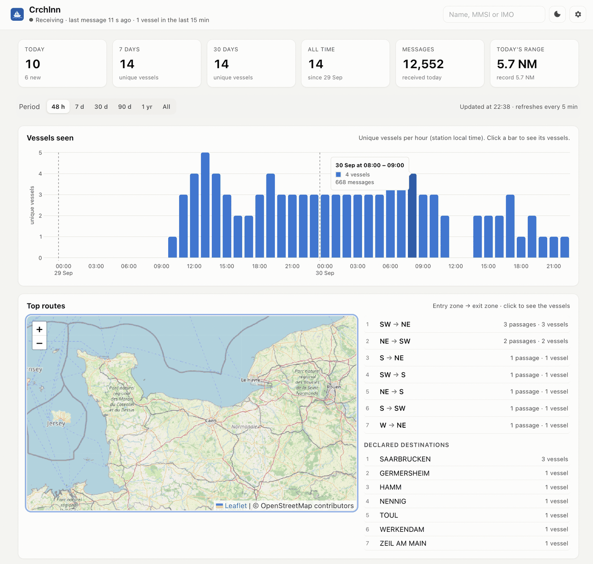
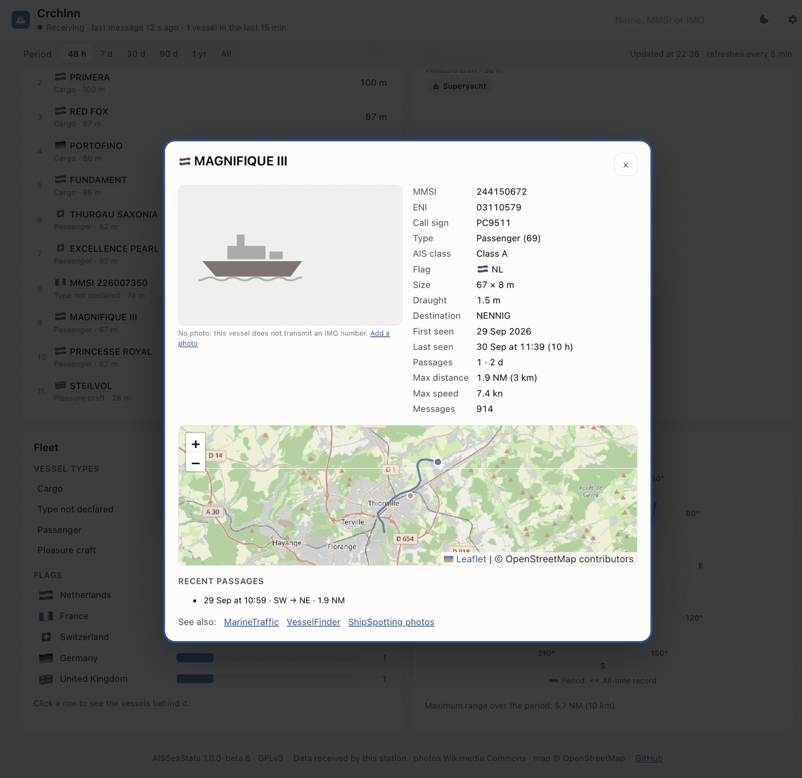
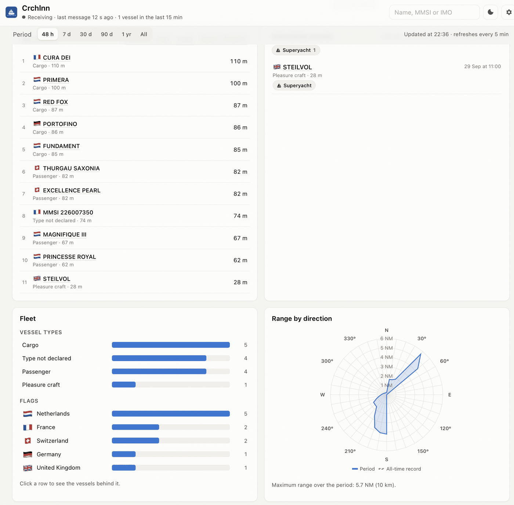
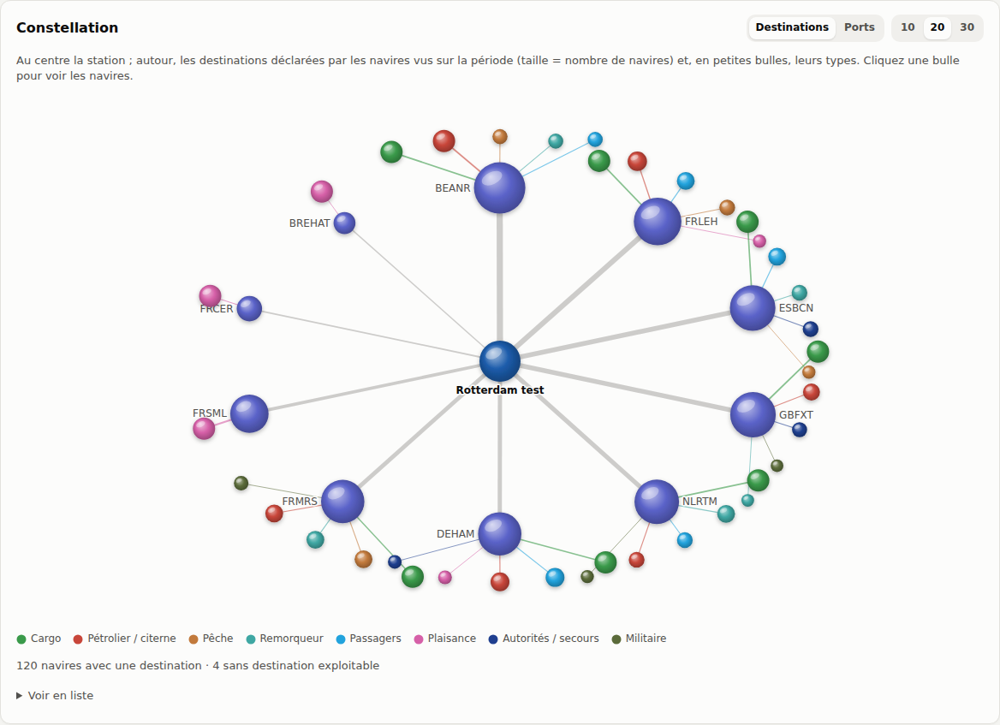
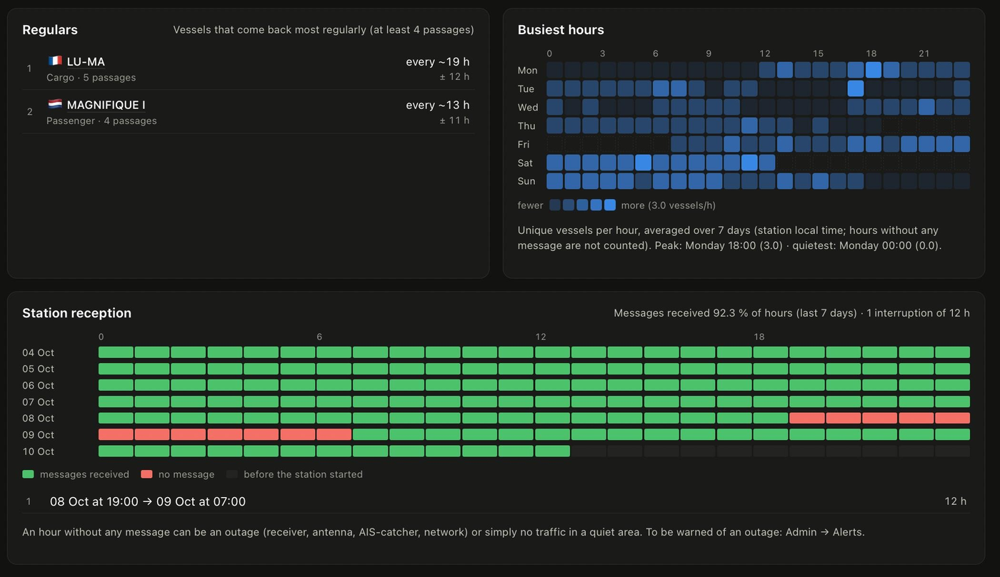
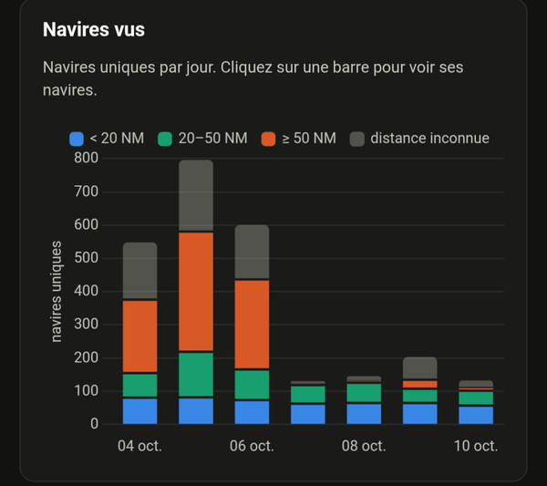
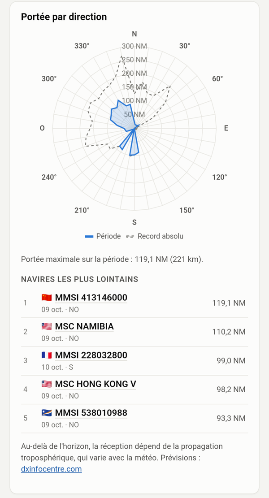

# AISSeaStats — guide rapide

Statistiques longue durée pour une station [AIS-catcher](https://github.com/jvde-github/AIS-catcher), façon SkyStats : navires vus par heure, jour et mois, top routes sur une carte, top navires, navires remarquables (militaires, secours, grande plaisance, matières dangereuses, très grands navires, pavillons rares, liste de surveillance), flotte par type et pavillon, portée par direction, et une fiche navire avec photo au clic. Depuis la 1.1.0 : navires vus par tranche de distance, jours de propagation exceptionnelle et navires les plus lointains, habitués (temps entre deux passages), heures d'affluence et réception de la station heure par heure. En 1.1.1 : tranche de distance de chaque navire dans la liste d'une barre, navire, date et heure de chaque record de portée. En 1.1.3 : carte de densité du trafic (heatmap des trajets), avec la portée par direction depuis la 1.1.4. En 1.1.5 : routes tracées le long de leur trajet réel le plus typique. En 1.2.0 (bêta) : capteurs Home Assistant par MQTT, alertes navires et résumés quotidiens ou hebdomadaires, constellation des destinations et réseau des ports, records, signal et distance.



<p>
  
  
</p>





<p>
  
  
</p>

## Prérequis

| | Minimum | Recommandé |
| --- | --- | --- |
| Machine | Linux 64 bits : Raspberry Pi 4 ou 5 sous **Raspberry Pi OS 64 bits**, ou toute machine amd64 | Pi 4 (2 Go et plus) ou Pi 5 |
| Mémoire disponible | 512 Mo | 1 Go |
| Disque libre | 1 Go | 2 Go, idéalement sur SSD plutôt que carte SD |
| Docker | Docker Engine avec le plugin Compose | dernière version stable |
| AIS-catcher | 0.29 ou plus récent, joignable par le réseau | dernière version |

Les systèmes 32 bits (`armv7l`, `armv6l`) ne sont pas pris en charge : l'image officielle MariaDB n'existe qu'en 64 bits.

Vérifications avant installation :

```sh
uname -m                  # doit afficher aarch64 ou x86_64
docker compose version    # doit afficher une version
free -h                   # colonne « available »
df -h .                   # colonne « Avail »
```

Pas encore de Docker ? `curl -fsSL https://get.docker.com | sh`, puis `sudo usermod -aG docker $USER` et reconnectez-vous.

`install.sh` refait ces vérifications et s'arrête avec un message clair s'il manque quelque chose.

## Installation

```sh
git clone https://github.com/Crchlnn/AISSeaStats.git
cd AISSeaStats
./install.sh
```

Le script télécharge l'**image toute prête** (Raspberry Pi 64 bits et PC, environ une minute), crée `.env` avec des mots de passe aléatoires et démarre trois conteneurs : `db`, `app` et `worker`. Si l'image ne peut pas être téléchargée, il la construit sur la machine.

Vous préférez construire l'image vous-même ? `./install.sh --build`. **Comptez alors 5 à 10 minutes sur un Raspberry Pi** (6 min 30 mesurées sur un Pi 4), 1 à 2 minutes sur un PC : les extensions PHP sont compilées une fois. Les deux façons donnent le même résultat et peuvent être échangées à tout moment (voir [Mettre à jour](#mettre-à-jour)).

Ouvrez ensuite `http://<ip-du-pi>:8095`. L'assistant demande le **code d'installation** affiché à la fin d'`install.sh` (aussi dans `docker compose logs app`, ou avec `docker compose exec app php bin/setup-code.php`) : seule la personne qui gère le serveur peut devenir administrateur. Il demande ensuite le nom et la position de la station, le fuseau, la langue et un mot de passe d'administration, puis affiche le **jeton** et la ligne à ajouter à AIS-catcher.

**Sans Git**, avec la seule image toute prête :

```sh
mkdir aisseastats && cd aisseastats
curl -fsSLO https://raw.githubusercontent.com/Crchlnn/AISSeaStats/main/docker-compose.yml
curl -fsSL https://raw.githubusercontent.com/Crchlnn/AISSeaStats/main/.env.example -o .env
nano .env                  # mettez de longues valeurs aléatoires dans DB_PASSWORD et DB_ROOT_PASSWORD
docker compose up -d
docker compose exec app php bin/setup-code.php   # le code demandé par l'assistant
```

**Image toute prête** : `ghcr.io/crchlnn/aisseastats`, pour `linux/arm64` (Raspberry Pi 4/5 sous système 64 bits) et `linux/amd64`, publiée automatiquement par GitHub Actions à chaque version. Étiquettes : `latest` (dernière version, par défaut), `1` (toutes les versions 1.x, nouveautés comprises, jamais une 2.0), `1.1` (corrections de la 1.1 seulement), `1.1.2` (exactement cette version), `1.2.0-beta.1` (version de test : seulement cette étiquette exacte, jamais `latest`, `1` ni `1.2`) ; pour en fixer une, mettez par exemple `AISSEASTATS_VERSION=1.1` dans `.env`. Les évolutions de la base s'appliquent au démarrage du conteneur : un outil de mise à jour automatique (Watchtower ou équivalent) qui télécharge la nouvelle image et redémarre `app` et `worker` fonctionne avec vos données. Les mises à jour s'installent alors sans vous : gardez une sauvegarde, ou fixez une étiquette pour choisir le moment.

## Brancher AIS-catcher

### Mode « managed » (interface web)

Dans AIS-catcher : **Output → HTTP → ajouter une sortie**, puis :

| Champ AIS-catcher | Valeur |
| --- | --- |
| Description | libre, par ex. `AISSeaStats` |
| Link | vide |
| URL | `http://<ip-du-pi>:8095/ingest.php` |
| Interval | `15` |
| ID | facultatif : nom de la station, visible dans le journal d'ingestion |
| Credentials | `aisseastats:<jeton>` |
| Protocol | `AISCATCHER` (valeur par défaut) |
| Gzip | activé |
| Response | au choix (activé : la réponse d'AISSeaStats apparaît dans le journal d'AIS-catcher) |
| Unique / Downsample Position | désactivés |

Laissez **Active** coché et **enregistrez avec l'icône de disquette** en haut à droite : tant que « You have unsaved changes » est affiché, rien n'est pris en compte.

L'assistant peut aussi pré-remplir le nom et la position de la station depuis le `config.json` d'AIS-catcher (lu dans le navigateur, jamais envoyé).

### Ligne de commande ou service

Ajoutez ces options à votre commande AIS-catcher existante (ne lancez pas la ligne seule) :

```
-M DTM -H http://<ip-du-pi>:8095/ingest.php interval 15 gzip on userpwd aisseastats:<jeton> id MaStation
```

Gardez `-M DTM` (signal, horodatage, pays du pavillon) : sans lui, le pavillon est déduit du MMSI et le niveau de signal n'est pas enregistré.

### Quelle adresse mettre ?

AIS-catcher tourne en général dans son propre conteneur Docker : `localhost` et `127.0.0.1` y désignent ce conteneur, pas AISSeaStats. Utilisez :

- l'adresse IP du Pi, par ex. `http://192.168.1.20:8095/ingest.php`, ou
- son nom dans votre DNS local (Pi-hole, box), **sans `.local`**, par ex. `http://monpi:8095/ingest.php`.

Les noms en `.local` (mDNS/Bonjour) marchent souvent dans le navigateur, mais pas depuis un conteneur Docker.

Les premiers chiffres arrivent dans la minute. Les routes apparaissent quand un navire a quitté la zone de réception depuis 2 h.

## Mettre à jour

Vos statistiques sont conservées : elles sont dans le volume Docker `aisseastats_db-data`, et vos réglages dans la base et dans `.env`, que ni Git ni la mise à jour ne touchent. Les évolutions de la base s'appliquent automatiquement au démarrage.

```sh
cd AISSeaStats                                    # le dossier d'installation
git pull                                          # récupère la nouvelle version (doc, docker-compose.yml)
docker compose pull && docker compose up -d       # image toute prête : téléchargement et redémarrage
```

ou, pour construire l'image sur votre machine comme avant :

```sh
cd AISSeaStats
git pull
docker compose up -d --build                      # reconstruit et redémarre
```

Les deux façons s'utilisent sur la même station, une mise à jour avec l'une, la suivante avec l'autre : elles donnent le même nom à l'image et utilisent les mêmes données. Une installation antérieure à la 1.1.2 construisait une image nommée `aisseastats:local` ; elle ne sert plus et peut être supprimée avec `docker image rm aisseastats:local`.

Rechargez ensuite la page (Ctrl+F5 / Cmd+Maj+R si l'affichage n'a pas changé). La version figure en bas de page, les nouveautés dans l'[historique des versions](#historique-des-versions).

- **Par prudence, faites une sauvegarde avant** (commande ci-dessous) : la mise à jour ne supprime rien, mais une sauvegarde ne coûte rien.
- **`git pull` refuse** (« your local changes would be overwritten ») : vous avez modifié un fichier suivi. `git stash`, puis `git pull`, puis `git stash pop` pour récupérer votre modification ; vos données ne sont pas concernées.
- **Revenir à une version précédente** : mettez `AISSEASTATS_VERSION=1.1.1` (par exemple) dans `.env` puis `docker compose pull && docker compose up -d`, ou `git checkout v1.1.1` puis `docker compose up -d --build`. Les évolutions de la base ne sont pas annulées : préférez restaurer une sauvegarde faite avant la mise à jour.
- Seul `docker compose down -v` efface les données (le `-v` supprime le volume).

**Tester une bêta.** Les versions de test ne sont publiées que sous leur étiquette exacte : les utilisateurs de `latest` ne les reçoivent jamais. Pour en essayer une : `git fetch --tags && git checkout v1.2.0-beta.1`, mettez `AISSEASTATS_VERSION=1.2.0-beta.1` dans `.env`, puis `docker compose pull && docker compose up -d` (ou `docker compose up -d --build`). Pour revenir aux versions publiées : `git checkout main && git pull`, videz `AISSEASTATS_VERSION`, puis `docker compose pull && docker compose up -d`. Les évolutions de la base d'une bêta restent (elles ne font qu'ajouter des tables) : une sauvegarde avant est une bonne idée.

## Historique des versions

La plus récente en premier. Détail, corrections et évolutions de la base pour chaque version : [CHANGELOG.fr.md](CHANGELOG.fr.md) (français) · [CHANGELOG.md](../CHANGELOG.md) (English).

| Version | Date | Nouveautés |
|---|---|---|
| 1.2.0-beta.1 | 23/10/2026 | Version de test. Capteurs Home Assistant par MQTT ; alertes navires (liste de surveillance, militaire, détresse, record de portée…) et résumés quotidiens ou hebdomadaires sur ntfy, Telegram, webhook, e-mail ou MQTT, avec heures calmes et canaux par type ; constellation des destinations et réseau des ports ; records ; signal et distance ; adresse publique pour les liens des alertes ; durcissement (temps limite des requêtes de l'API publique, vérifications de l'image, test de bout en bout de la pile Docker, [Exposer sur Internet](#exposer-sur-internet)) |
| 1.1.6 | 21/10/2026 | Corrections de la revue de sécurité : tentatives de connexion limitées, code d'installation à usage unique, photos cherchées seulement pour les navires reçus, envois refusés non journalisés, `INGEST_ALLOW` strict, worker sans root, option d'arrondi de la position publiée, expiration des sessions admin |
| 1.1.5 | 15/10/2026 | Top routes tracées le long de leur trajet réel le plus typique au lieu d'une ligne droite (fleuves, chenaux), flèches de même taille à tous les zooms ; plus de longueur minimale pour le mot de passe d'administration |
| 1.1.4 | 13/10/2026 | Carte de densité : portée de la période et record absolu de portée tracés par direction, chacun masquable ; historique calculé environ 5 fois plus vite après une mise à jour, avec son avancement affiché |
| 1.1.3 | 13/10/2026 | Correction : un lot d'AIS-catcher pouvait être perdu avec MariaDB 11.8 (« Record has changed since last read », ticket #2), désormais réessayé ; carte de densité du trafic sous la carte des routes (ticket #3) |
| 1.1.2 | 10/10/2026 | Image toute prête documentée et utilisée par défaut (`docker compose pull`), construction locale toujours possible ; top navires et habitués : 10, 20, 50 ou 100 par page, avec pages ; liste des navires d'une barre : tri par distance et filtre par tranche de distance |
| 1.1.1 | 10/10/2026 | Liste des navires d'une barre du graphique : carré de couleur de la tranche de distance de chaque navire, sa distance et les totaux par tranche ; infobulle du graphique de portée : navire, date et heure de chaque record ; heure du record dans les navires les plus lointains |
| 1.1.0 | 10/10/2026 | Graphique des navires par tranche de distance ; jours de propagation exceptionnelle et navires les plus lointains ; habitués et temps entre deux passages ; heures d'affluence (jour × heure) ; réception de la station heure par heure |
| 1.0.0-beta.8 | 06/10/2026 | Capture de débogage aussi écrite dans un fichier JSON Lines daté (contribution de @Phil353556) ; lien aiscatcher.org sur la fiche navire à la place de MarineTraffic, dont les liens ne fonctionnent plus |
| 1.0.0-beta.7 | 30/09/2026 | Capture de débogage des messages bruts dans l'admin ; explication quand le nom d'un navire n'a pas été reçu ; graphiques 30/90 jours sur toute la période |
| 1.0.0-beta.6 | 30/09/2026 | Alertes quand la réception s'arrête puis revient : ntfy, Telegram, webhook (Discord, Slack, Gotify, Home Assistant…) et e-mail, avec bouton de test ; URL heartbeat facultative pour détecter une station éteinte ; type des péniches tiré des données AIS Inland ; taille de la base plus claire dans l'admin |
| 1.0.0-beta.5 | 30/09/2026 | Dictionnaire des destinations dans l'admin (ex. `SAINT-MALO, ST-MALO, FR SML` → `FRSML`) ; destinations sans signification (`0`, `Q`…) affichées « Inconnue » ; clic sur une barre du graphique des navires pour en voir la liste ; portée maximale portée à 1 500 NM par défaut (propagation troposphérique), les positions lointaines devant être confirmées pour établir un record |
| 1.0.0-beta.4 | 30/09/2026 | Un seul sélecteur de période pour toute la page, mémorisé ; actualisation automatique ; clic sur un type, un pavillon, une route ou une destination pour lister ses navires ; barres de flotte lisibles sur téléphone ; vos propres photos de navires, puis Wikimedia Commons / Wikidata ; installation pré-remplie depuis le `config.json` d'AIS-catcher ; corrections de la carte « Access blocked » et des graphiques vides |
| 1.0.0-beta.3 | 29/09/2026 | Pavillon déduit du MMSI ; « pavillon rare » seulement à partir de 100 navires connus ; instructions AIS-catcher plus claires |
| 1.0.0-beta.2 | 29/09/2026 | Correction de « Invalid form token » sous Docker ; durée d'installation indiquée ; vérification mémoire et disque dans `install.sh` |
| 1.0.0-beta.1 | 29/09/2026 | Première version de test |

## Essayer avec des données simulées

```sh
docker compose exec app php bin/simulate.php --hours 72
docker compose exec app php bin/reset-data.php --yes    # pour repartir de zéro ensuite
```

## Commandes utiles

| Action | Commande |
| --- | --- |
| Mettre à jour (image toute prête) | `git pull && docker compose pull && docker compose up -d` |
| Mettre à jour (construite ici) | `git pull && docker compose up -d --build` |
| Sauvegarder | `docker compose exec db sh -c 'mariadb-dump -u root -p"$MARIADB_ROOT_PASSWORD" aisseastats' \| gzip > aisseastats.sql.gz` |
| Restaurer | `gunzip -c aisseastats.sql.gz \| docker compose exec -T db sh -c 'mariadb -u root -p"$MARIADB_ROOT_PASSWORD" aisseastats'` |
| Journaux | `docker compose logs -f app worker` |
| État | `docker compose ps` |
| Mot de passe admin perdu | `docker compose exec app php bin/reset-admin.php` |
| Arrêter (données conservées) | `docker compose down` |
| Tout supprimer | `docker compose down -v` |

## Nouveautés 1.2.0

- **Constellation** : vue *Destinations* — la station au centre, autour les destinations déclarées par les navires de la période (taille = nombre de navires, variantes regroupées par le dictionnaire, destinations inconnues ou sans signification écartées) et, en petites bulles, leurs types de navires. Vue *Ports* — quand un navire change de destination, l'ancien port est relié au nouveau ; les flèches suivent le sens du trajet, leur épaisseur est le nombre de navires. Cet historique est enregistré depuis la 1.2.0 : la vue se remplit en quelques semaines. Un clic sur une bulle ou une flèche liste les navires ; « Voir en liste » donne la même information en texte.
- **Records** : réception la plus lointaine, plus grand navire, plus rapide (classes A et B, jusqu'à 60 nœuds pour écarter positions aberrantes et aéronefs), pavillon le plus rare, journée la plus chargée, plus longue présence continue, premier navire reçu, avec le navire et la date.
- **Signal et distance** : niveau moyen du signal des positions reçues, par tranches de 2 NM, sur la période ; choisissez une direction pour la comparer à toute la station. Une station saine montre une baisse régulière avec la distance ; une direction qui chute tôt signale un obstacle ou le diagramme de l'antenne. Le niveau vient du champ `signalpower` des messages d'AIS-catcher ; enregistré depuis la 1.2.0.
- **Alertes navires et résumés** (admin) : mêmes canaux que les alertes de réception, plus MQTT. Motifs activables un par un : liste de surveillance, détresse, militaire, autorités et secours, matières dangereuses, très grand navire, pavillon rare, grande plaisance, première visite, nouveau record de portée, propagation exceptionnelle (actifs par défaut une fois les alertes navires activées : surveillance, détresse, militaire, record de portée). Un navire n'alerte qu'une fois par passage et par motif ; plusieurs motifs font un seul message, avec type, pavillon, distance, direction, destination et, si l'adresse publique de la page est renseignée, un lien qui ouvre sa fiche. **Heures calmes** (la détresse passe quand même) et **maximum par heure** : les alertes retenues sont notées au journal, pas envoyées plus tard. **Résumés** quotidien (20 h par défaut) et/ou hebdomadaire (dimanche 20 h). **Canaux par type de message** : par exemple réception par e-mail, navires sur ntfy et MQTT, résumés sur Telegram. Les 100 derniers messages sont listés avec leur résultat.
- **Navires militaires** : aucune série de MMSI n'est réservée aux navires de guerre. Chaque pays attribue les siens (le plus souvent dans sa plage normale), et beaucoup n'émettent pas, ou avec le type AIS 35. La règle repère le type 35 et les préfixes MMSI que vous indiquez dans l'admin.

## Home Assistant (MQTT)

Dans l'admin, **MQTT / Home Assistant** : serveur (par exemple le module Mosquitto de Home Assistant), port, identifiant et mot de passe, TLS facultatif (avec ou sans vérification du certificat, pour un certificat auto-signé sur le réseau local). « Envoyer un test » se connecte et publie un message de test.

Avec la découverte activée (par défaut), un appareil **AISSeaStats** apparaît dans Home Assistant avec ses capteurs : navires aujourd'hui, navires actifs, nouveaux navires du jour, messages du jour, messages de la dernière heure, portée du jour, record de portée, âge du dernier message, et un capteur de connectivité *Réception*. Le worker garde une connexion ouverte et publie chaque minute :

| Sujet | Contenu |
| --- | --- |
| `aisseastats/<station>/state` | JSON de toutes les valeurs, conservé (retain) |
| `aisseastats/<station>/availability` | `online` / `offline` ; le serveur publie lui-même `offline` si le worker s'arrête (last will) |
| `aisseastats/<station>/event` | alertes et résumés envoyés vers MQTT (QoS 1, non conservés) |
| `homeassistant/…/aisseastats_<id>/…/config` | découverte, conservée, rafraîchie toutes les heures |

Aucun message n'est publié par navire. `<station>` est le nom de la station en minuscules (lettres, chiffres et tirets) ; les préfixes sont modifiables. Exemple d'automatisation : déclencheur `mqtt` sur `aisseastats/+/event`, condition `{{ trigger.payload_json.kind == 'vessel' }}`, puis une notification avec `{{ trigger.payload_json.title }}`.

## Exposer sur Internet

AISSeaStats est fait pour un réseau domestique. Pour rendre la page accessible de l'extérieur :

1. **Passez par un reverse proxy en HTTPS** (Caddy, Nginx Proxy Manager, Traefik, Cloudflare Tunnel…), jamais par le port 8095 directement. Exemple avec Caddy, qui obtient le certificat tout seul :

   ```
   ais.mondomaine.fr {
       @prive path /admin.php /setup.php /ingest.php
       respond @prive 404
       reverse_proxy 127.0.0.1:8095
   }
   ```

   Seules les statistiques sont publiées : l'admin, l'installation et l'ingestion restent accessibles depuis le réseau local à `http://<ip-du-pi>:8095`. Pour l'admin depuis l'extérieur, préférez un VPN (WireGuard, Tailscale) à une ouverture.
2. **N'écoutez que sur le Pi** quand le proxy tourne sur la même machine. Créez `docker-compose.override.yml` à côté de `docker-compose.yml` (Docker Compose 2.24 ou plus récent) :

   ```yaml
   services:
     app:
       ports: !override
         - "127.0.0.1:8095:8080"
   ```

   puis `docker compose up -d`. AIS-catcher sur le même Pi continue d'envoyer vers `http://127.0.0.1:8095/ingest.php` ; un AIS-catcher sur une autre machine doit alors passer par l'adresse du proxy. Git ne suit pas ce fichier : il survit aux mises à jour.
3. **Limitez le débit des requêtes** au niveau du proxy s'il le permet (`limit_req` de Nginx, module rate-limit de Caddy, règles Cloudflare), et **n'ouvrez que les ports 80/443** sur la box ou le pare-feu.
4. Renseignez **Admin → Station → adresse publique** pour que les alertes pointent vers la page publique, et pensez à **arrondir la position publiée**.
5. Facultatif : `docker compose -f docker-compose.yml -f docker-compose.hardened.yml up -d` pour le durcissement supplémentaire des conteneurs.

Derrière un proxy, l'adresse vue par `INGEST_ALLOW` et par la limite de connexions est celle du proxy : gardez l'ingestion sur le réseau local comme dans l'exemple.

## Bon à savoir

- **Sécurité (1.1.6)** : 10 mauvais mots de passe depuis une adresse (ou 100 au total) en 15 minutes bloquent la connexion admin pendant 15 minutes (`bin/reset-admin.php` lève le blocage) ; une session admin expire après 8 h d'inactivité ; la page publique ne pose aucun cookie aux visiteurs. Admin → Station permet d'arrondir à environ 1 km la position publiée sur la page et l'API, utile si l'antenne est à domicile et la page publique. Une entrée invalide dans `INGEST_ALLOW` est ignorée (et signalée dans les journaux) au lieu d'ouvrir l'ingestion à tous. Le conteneur worker tourne en `www-data`, sans privilège.
- **Sécurité (1.2.0)** : chaque requête de l'API publique est arrêtée au bout de 20 secondes, pour que personne ne puisse occuper la base ; la construction de l'image échoue s'il manque une extension PHP ; un avertissement (non bloquant) s'affiche pour un mot de passe admin de moins de 8 caractères ; MQTT vérifie le certificat TLS du serveur sauf si vous le désactivez ; mots de passe et jetons ne sont jamais réaffichés dans l'admin. `docker-compose.hardened.yml` (facultatif) retire aussi au conteneur web les privilèges dont ses serveurs n'ont pas besoin.

- **Zones nommées** (page admin) : par défaut une route va d'un secteur à un autre (`SO → NE`). Ajoutez une écluse, un port ou une ville pour lire `Port → Écluse nord`.
- **Dictionnaire des destinations** (page admin) : les équipages saisissent la destination librement (`FRSML`, `FR SML`, `SAINT-MALO`, `ST-MALO`…). Regroupez les variantes d'un port sous un seul nom, par exemple `SAINT-MALO, ST-MALO, FR SML` → `FRSML`. Les valeurs sans signification (`0`, `Q`…) s'affichent « Inconnue ».
- **Portée maximale plausible** (1 500 NM par défaut) : la propagation troposphérique peut amener des messages de plus de 1 000 NM. Au-delà de 50 NM, une position ne compte pour les records de portée que si le navire a été reçu peu avant à une position cohérente.
- **Graphique des navires** : cliquez sur une barre pour voir la liste des navires de cette heure, ce jour ou ce mois.
- **Photos** : dans l'ordre, votre propre photo (admin → Photos de navires, ou lien « Ajouter une photo » sur la fiche quand vous êtes connecté), puis une photo libre de Wikimedia Commons ou Wikidata (par IMO ou MMSI). Beaucoup de bateaux de pêche et de plaisance n'ont aucune photo libre : ajoutez la vôtre. VesselFinder, ShipSpotting et aiscatcher.org sont proposés en liens : leurs conditions n'autorisent pas la récupération automatique de leurs photos.
- **Alertes** (page admin) : AIS-catcher ne prévient pas quand la réception s'arrête ; AISSeaStats envoie un message après N minutes sans rien recevoir (30 par défaut), puis un autre quand la réception revient. Canaux, au choix et cumulables : **ntfy** (application sur téléphone, serveur public ntfy.sh ou le vôtre, avec un nom de sujet difficile à deviner), **Telegram** (bot créé avec @BotFather), **webhook** (JSON lisible par Discord, Slack, Gotify, Home Assistant…) et **e-mail** (serveur SMTP de votre messagerie). Le bouton « Envoyer un test » vérifie chaque canal. Ces alertes partent du Pi : s'il est éteint ou sans réseau, seule une URL **heartbeat** (healthchecks.io, Uptime Kuma en mode Push…) permet d'être prévenu.
- **Lire les statistiques (1.1.0)** : chaque navire compte une fois par heure, jour ou mois, dans la tranche de sa position la plus lointaine (moins de 20 NM, 20 à 50 NM, au-delà, ou distance inconnue). Un jour est signalé en **propagation exceptionnelle** (triangle orange) quand sa portée vaut au moins deux fois la portée habituelle (médiane des 30 jours précédents), avec 20 NM de plus et au moins 3 navires entendus au-delà de 1,5 fois cette portée ; prévisions sur [dxinfocentre.com](https://dxinfocentre.com/tropo_eur.html). Les **habitués** sont classés selon la régularité du temps entre deux passages (de la fin de l'un au début du suivant, 4 passages au moins). Les **heures d'affluence** ne comptent que les heures avec des messages. Dans la **réception de la station**, une case rouge signifie « aucun message » : panne, ou simplement pas de trafic sur une zone calme.
- **Top routes (1.1.5)** : une route est le couple « zone où le navire a été entendu pour la première fois → zone où il l'a été pour la dernière fois » (secteurs autour de la station, ou vos zones nommées). Sur la carte, chaque route suit son trajet réel le plus typique : parmi ses 12 derniers passages qui ont encore des positions (gardées 30 jours par défaut), celui qui ressemble le plus aux autres. Sur un fleuve, elle suit les méandres ; un détour ou une position aberrante n'est pas choisi. Sans positions pour la période, la route reste une ligne droite entre les points d'entrée et de sortie moyens.
- **Densité du trafic (1.1.3)** : chaque heure, un navire vu dans une zone d'environ 1 km y compte une fois (navire-heures) : un rail emprunté par beaucoup de navires ressort, un navire à quai toute la journée compte une fois par heure. Stations de base et aides à la navigation ne comptent pas. Le worker ajoute chaque heure environ 5 minutes après sa fin et garde 400 jours : la carte couvre aussi les longues périodes. À l'installation de la 1.1.3, elle démarre avec les positions encore conservées (30 jours par défaut), en 3 minutes environ. La portée de la période (trait plein) et le record absolu de portée (pointillés) sont tracés par secteur de 10° sur la heatmap, comme le graphique de portée ; la case en haut à droite de la carte masque l'un ou l'autre.
- **Liste d'une barre et records (1.1.1)** : un clic sur une barre liste ses navires avec un carré de la couleur de leur tranche et leur distance maximale ; les totaux par tranche, en haut, comptent toute la barre même si la liste s'arrête à 300 navires. Tri par messages (par nom pour une heure) ou par distance ; un clic sur une tranche ne liste que ses navires, un second clic les montre tous. Au survol du graphique de portée, chaque secteur de 10° indique le navire du record, sa date et son heure. Les records antérieurs à la 1.1.1 retrouvent leur heure grâce aux positions encore conservées (30 jours) ; les plus anciens n'affichent que leur jour.
- **Navire sans nom** : le nom n'arrive que dans le message d'identité (AIS type 5, ou 24 en classe B), envoyé toutes les 6 minutes et plus long qu'une position, donc le premier perdu en limite de portée. Dans l'admin, **Débogage : messages reçus** enregistre ce qu'AIS-catcher envoie pour ce MMSI et montre quels types de messages arrivent.
- **Taille de la base** : l'admin affiche la taille des statistiques (quelques Mo). Le dossier de MariaDB dépasse 100 Mo dès l'installation, car il contient des fichiers de taille fixe, surtout le journal de transactions de 96 Mo. C'est normal, seules les données grandissent.
- **Carte « Access blocked »** ou **graphique vide après changement de période** : corrigés en 1.0.0-beta.4, mettez à jour puis rechargez la page.
